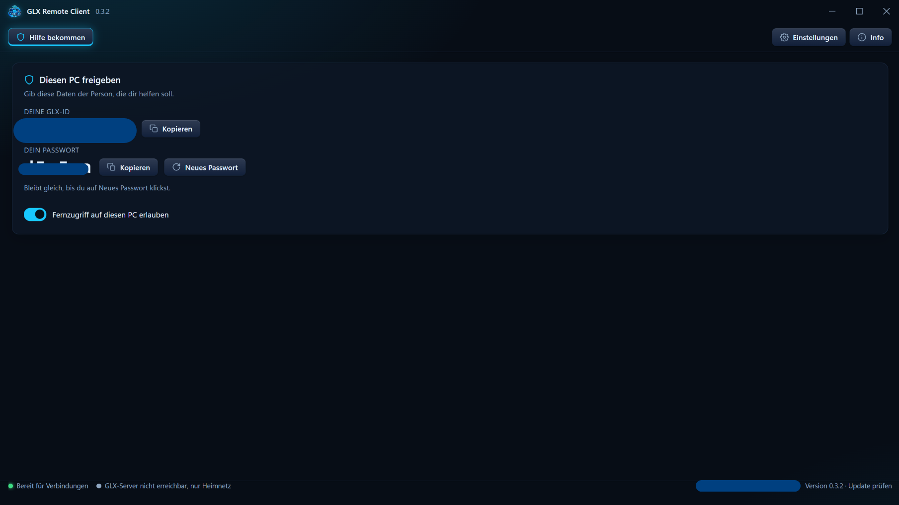
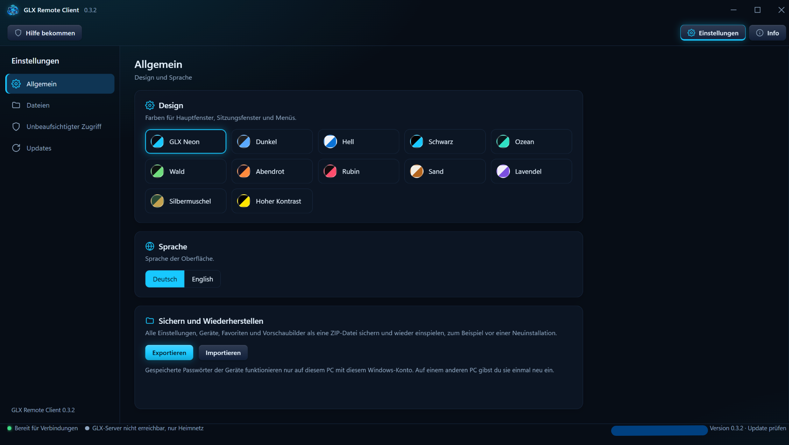
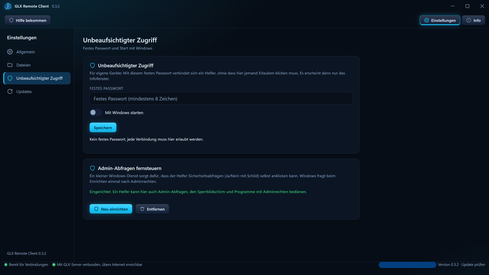
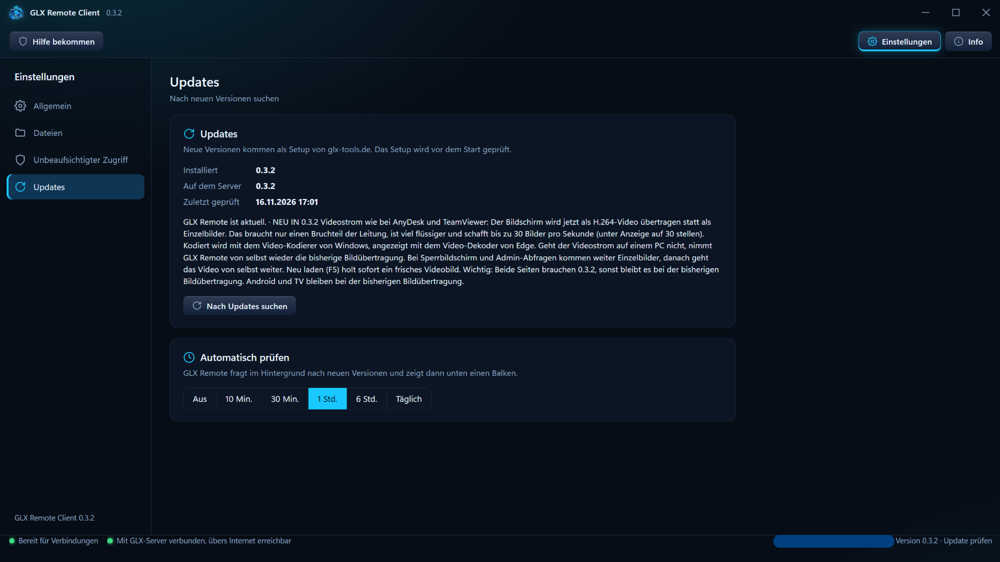

🌍 Sprachen: [🇺🇸 English](README.md) | [🇩🇪 Deutsch](README.de.md)

# 💠 GLX Remote Client

### Hilfe am eigenen PC, ohne lange Erklärungen.

*Einmal installieren, und eine Vertrauensperson mit GLX Remote Windows kann dir jederzeit direkt auf deinem Bildschirm helfen.* ⚡

   

---

## ⬇️ Download

👉 Neueste Version: [Releases](../../releases/latest)  
👉 Shop und Lizenzen: [glx-tools.de](https://glx-tools.de/product/glx-remote-client/)

---

## 📖 Über GLX Remote Client

### Hilfe holen, ohne lange zu erklären

Du kommst am PC nicht weiter? Mit GLX Remote Client kann dir eine vertraute Person, die GLX Remote Server nutzt, direkt auf deinem Bildschirm helfen. Du nennst ihr deine GLX-ID und dein Passwort, klickst auf Erlauben, und sie sieht und steuert deinen PC, bis das Problem gelöst ist.

### Immer bereit, ohne zu stören

GLX Remote Client wird einmal installiert und wartet dann leise unten im Infobereich neben der Uhr. Deine GLX-ID und dein Passwort bleiben gleich, bis du selbst ein neues Passwort erstellst. So kann dir dein Helfer beim nächsten Mal noch schneller helfen.

Auf Wunsch startet GLX Remote Client mit Windows. Für deine eigenen Rechner kannst du ein festes Passwort für den unbeaufsichtigten Zugriff festlegen, dann ist keine Bestätigung nötig.

### Du behältst den Überblick

Während der Hilfe zeigt ein Infofenster, wer verbunden ist: Name, PC, GLX-ID und die Dauer der Sitzung. Dort kannst du chatten, über dein Mikrofon mit dem Helfer sprechen, ihm eine Datei oder einen Screenshot schicken und die Verbindung mit einem Klick trennen.

Dateien, die dir dein Helfer schickt, landen in Downloads\GLX Remote. Den Ordner kannst du in den Einstellungen ändern.

### Sicher

Ohne dein Passwort kommt niemand auf deinen PC. Jede Verbindung musst du bestätigen, außer du hast selbst ein festes Passwort für den unbeaufsichtigten Zugriff eingerichtet. Nach fünf falschen Passwörtern sperrt GLX Remote weitere Versuche für einige Minuten.

### Einfach gehalten

GLX Remote Client läuft im GLX-Design, auf Deutsch und Englisch, mit wenigen, klaren Einstellungen. Neue Versionen findet das Programm selbst und installiert sie auf Wunsch mit einem Klick.

### Verbindung im Netzwerk und über das Internet

Im selben Netzwerk, zum Beispiel zu Hause oder im Büro, funktioniert die Hilfe schon heute direkt von PC zu PC.

Über das Internet, also wenn dein Helfer an einem anderen Ort sitzt, läuft die Verbindung über den GLX-Server.

---

## 📸 Überblick & Screenshots

### 1️⃣ Hauptfenster

### 2️⃣ Ansicht 2

### 3️⃣ Ansicht 3

### 4️⃣ Ansicht 4

---

## ✨ Funktionen

- 🚀 **Hilfe ohne lange Erklärungen:** Nenne deinem Helfer deine GLX-ID und dein Passwort, klicke auf Erlauben, und er sieht und steuert deinen PC, bis das Problem gelöst ist.
- 🧩 **Immer bereit, nie im Weg:** Läuft still im Infobereich neben der Uhr und kann mit Windows starten.
- ⚙️ **Feste GLX-ID und Passwort:** ID und Passwort bleiben gleich, bis du selbst ein neues Passwort erzeugst, so geht die nächste Hilfe noch schneller.
- 🔒 **Infofenster während der Sitzung:** Zeigt Name, PC, GLX-ID und Dauer des Helfers, damit du immer weißt, wer verbunden ist.
- 📂 **Chat und Sprache:** Schreibe Nachrichten oder sprich über dein Mikrofon mit deinem Helfer, ganz ohne Telefon.
- ⚡ **Dateien und Screenshots senden:** Schicke deinem Helfer eine Datei oder einen Screenshot; empfangene Dateien landen in Downloads\GLX Remote (änderbar).
- 🎨 **Unbeaufsichtigter Zugriff auf eigene PCs:** Lege ein festes Passwort fest und verbinde dich mit deinen eigenen Computern, ohne dass jemand auf Erlauben klicken muss.
- 🌍 **Von Haus aus sicher:** Kein Zugriff ohne dein Passwort, jede Verbindung wird bestätigt, und fünf falsche Passwörter sperren weitere Versuche.
- 🛠️ **Heimnetz und Internet:** Direkte Verbindung im selben Netzwerk, verschlüsselt über den GLX-Server im Internet.
- 📊 **Für immer kostenlos:** Keine Lizenz, keine Werbung. GLX-Design, Deutsch und Englisch, Updates mit einem Klick.

---

## 🧩 Systemanforderungen

- Windows 10 oder Windows 11 (64-Bit)
- Microsoft Edge WebView2 (in aktuellen Windows-Versionen enthalten)

---

## 🧪 Testzeitraum & Lizenz

Kostenlos. Der Helfer braucht GLX Remote Windows.

---

## 🔐 Datenschutz

Niemand kann sich ohne dein Passwort verbinden, und jede Verbindung muss bestätigt werden, außer du richtest den unbeaufsichtigten Zugriff selbst ein.

---

## 🔗 Mehr zu diesem Produkt

👉 [glx-tools.de](https://glx-tools.de/product/glx-remote-client/)  
Support: **info@glx-tools.de**

---

## 📄 Lizenz

Copyright © 2026 GLX Tools – Gordon Lehmann. Alle Rechte vorbehalten.  
Dies ist proprietäre kommerzielle Software. Es wird keine Open-Source-Lizenz gewährt. Dieses Repository enthält nur Release-Downloads und Dokumentation; der Quelltext wird nicht veröffentlicht.

---

Mit ❤️ gemacht von **Dreamdancer100**

