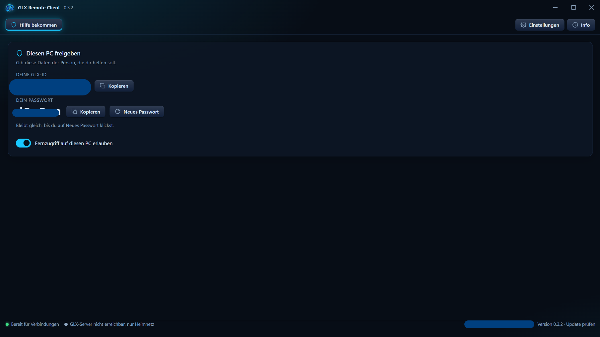
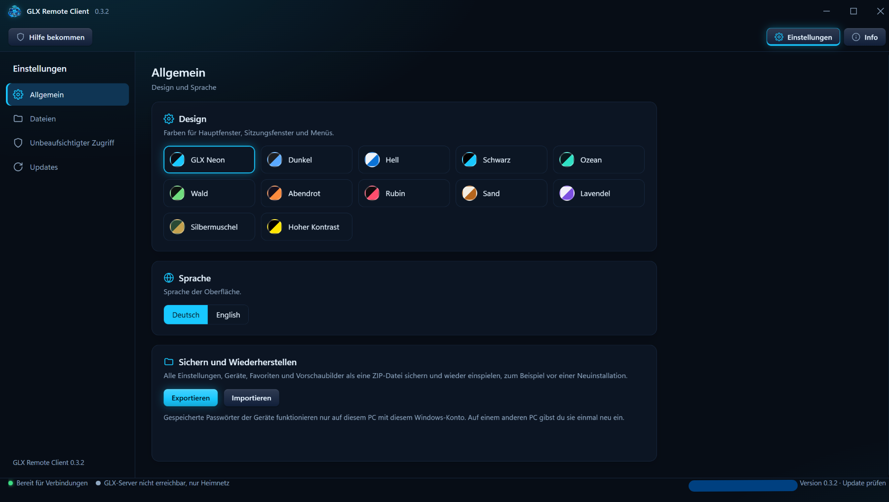
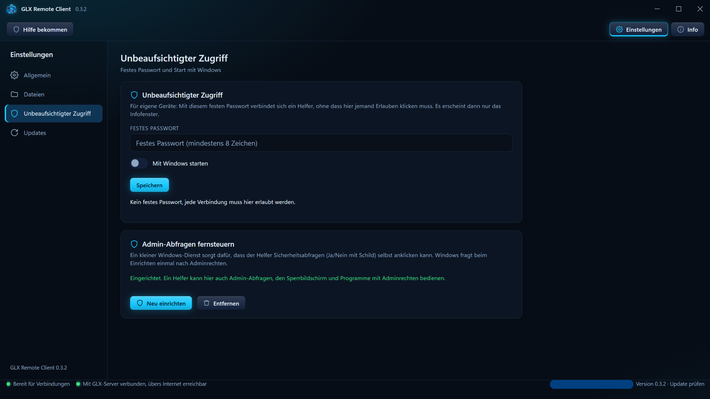
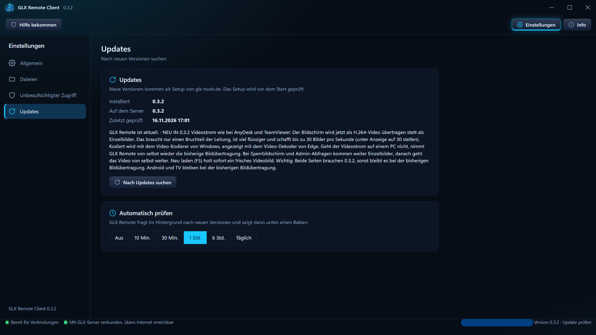

🌍 Languages: [🇺🇸 English](README.md) | [🇩🇪 Deutsch](README.de.md)

# 💠 GLX Remote Client

### Get help on your PC, without long explanations.

*Install GLX Remote Client once, and a trusted person with GLX Remote Windows can help you on your screen whenever you need it.* ⚡

   

---

## ⬇️ Download

👉 Latest version: [Releases](../../releases/latest)  
👉 Shop and licences: [glx-tools.de](https://glx-tools.de/product/glx-remote-client/)

---

## 📸 Overview & Screenshots

### 1️⃣ Main window

### 2️⃣ View 2

### 3️⃣ View 3

### 4️⃣ View 4

---

## ✨ Features

- 🚀 **Help without long explanations:** Tell your helper your GLX ID and password, click Allow, and they see and control your PC until the problem is solved.
- 🧩 **Always ready, never in the way:** Runs quietly in the notification area and can start with Windows.
- ⚙️ **Stable GLX ID and password:** Your ID and password stay the same until you create a new password, so the next help session is even faster.
- 🔒 **Info window during sessions:** Shows name, PC, GLX ID and duration of the helper, so you always know who is connected.
- 📂 **Chat and voice:** Write messages or talk to your helper over your microphone, no phone needed.
- ⚡ **Send files and screenshots:** Send a file or screenshot to your helper; received files land in Downloads\GLX Remote (changeable).
- 🎨 **Unattended access for own PCs:** Set a fixed password and connect to your own computers without someone clicking Allow.
- 🌍 **Secure by default:** No access without your password, every connection is confirmed, and five wrong passwords lock further attempts.
- 🛠️ **Local network and internet:** Direct connection in the same network, encrypted connection through the GLX server over the internet.
- 📊 **Free forever:** No licence, no ads. GLX design, German and English, updates with one click.

---

## 🧩 Requirements

- Windows 10 or Windows 11 (64-bit)
- Microsoft Edge WebView2 (included in current Windows versions)

---

## 🧪 Trial & License

Free of charge. The helper needs GLX Remote Windows.

---

## 🔐 Privacy

Nobody can connect without your password, and every connection must be confirmed unless you set up unattended access yourself.

---

## 🔗 More about this product

👉 [glx-tools.de](https://glx-tools.de/product/glx-remote-client/)  
For support: **info@glx-tools.de**

---

## 📄 License

Copyright © 2026 GLX Tools – Gordon Lehmann. All rights reserved.  
This is proprietary commercial software. No open-source license is granted. This repository contains release downloads and documentation only; the source code is not published.

---

Made with ❤️ by **Dreamdancer100**

